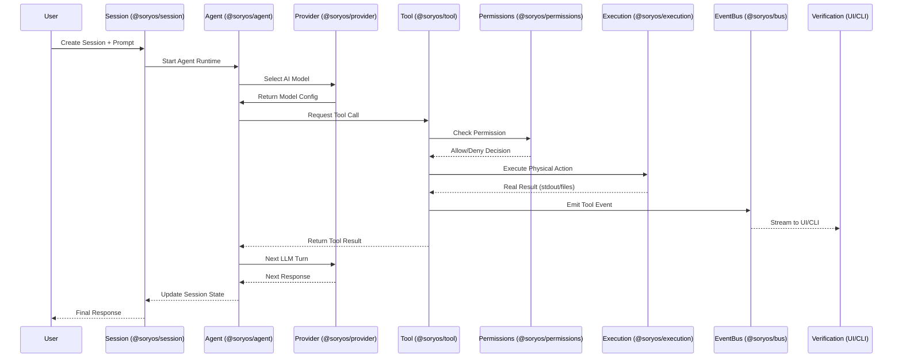
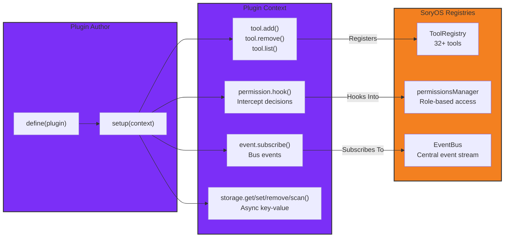

# SoryOS-Code

**Describe an app. Watch an agent build it — live.**


[](https://nodejs.org/)
[](https://nextjs.org/)
[](https://react.dev/)
[](https://turbo.build/)

---

SoryOS-Code is an AI coding workbench powered by an extensible **Sandbox Provider Architecture**. You describe what you want in natural language; an autonomous AI agent plans, writes files, runs commands, and verifies the result inside an isolated Sandbox Provider — while you follow every step in a Cursor-style interface.

No code generation in chat bubbles. Real files. Real terminal. Real preview.

## Multi-Provider Sandbox Architecture

SoryOS-Code abstracts code execution behind a unified `SandboxProvider` contract. You can seamlessly switch providers from a single interface:

- ☁️ **E2B** (`e2b`) — Remote cloud sandbox for complete development, terminal, processes, and builds.
- ☁️ **Vercel Sandbox** (`vercel`) — Cloud execution, builds, files, and commands.
- ☁️ **Google Cloud Run** (`google-cloud-run`) — Cloud execution & long-running build jobs (`cargo build`, `cmake`, `gcc`, ISO generation, cross-compilation).
- ☁️ **GitHub Codespaces** (`github-codespaces`) — Cloud development environment workspace.
- 💻 **Local** (`local`) — Local machine execution directly on the user's system.

## Stack

| Layer   | Tech                                                |
| ------- | --------------------------------------------------- |
| Web     | Next.js 16, React 19, Tailwind 4, shadcn/ui, Monaco |
| API     | FastAPI, SQLAlchemy + SQLite, SSE streaming         |
| Agent   | LangGraph, DeepSeek (`langchain-deepseek`)          |
| Runtime | E2B code interpreter sandboxes                      |
| Plugins | `@soryos/plugin` (Promise-based plugin authoring API) |

## Architecture

### Monorepo Layout

```mermaid
graph TB
    subgraph apps["Apps"]
        web["apps/web<br/>Next.js 16 + React 19<br/>Landing + Chat UI + Preview"]
        api["apps/api<br/>FastAPI + LangGraph<br/>Agent Runtime + Routes"]
    end

    subgraph packages["@soryos/* Packages (33 total)"]
        schema["@soryos/schema<br/>Domain Types & Contracts"]
        core["@soryos/core<br/>Error Classes"]
        bus["@soryos/bus<br/>Event Bus"]
        permissions["@soryos/permissions<br/>Role-Based Security"]
        execution["@soryos/execution<br/>Physical Command/File Execution"]
        tool["@soryos/tool<br/>ToolRegistry + ToolExecutor<br/>32 built-in tools + MCP"]
        agent["@soryos/agent<br/>Multi-Turn Agent Runtime"]
        workspace["@soryos/workspace<br/>ActiveWorkspace State"]
        session["@soryos/session<br/>Session Store & History"]
        provider["@soryos/provider<br/>Multi-Model AI Provider Registry"]
        filesystem["@soryos/filesystem<br/>Filesystem Adapter"]
        git["@soryos/git<br/>Git Tracking & Branch Management"]
        pty["@soryos/pty<br/>Interactive PTY Stream Manager"]
        devRunner["@soryos/dev-runner<br/>Dev Server Orchestrator"]
        cli["@soryos/cli<br/>Autonomous CLI Engine"]
        sandbox["@soryos/sandbox<br/>Sandbox Environments<br/>E2B, Vercel, Codespaces, Cloud Run"]
        jobs["@soryos/jobs<br/>Inngest Background Job Queue"]
        theme["@soryos/theme<br/>OKLCH Theme System"]
        plugin["@soryos/plugin<br/>Promise-Based Plugin API"]
        shared["@soryos/shared<br/>Shared Utilities"]
    end

    subgraph infra["Infrastructure"]
        sqlite["SQLite<br/>Local Database (Free)"]
        inngest["Inngest<br/>Background Job Queue"]
        e2b["E2B<br/>Sandbox Provider"]
    end

    web -->|REST + SSE| api
    api -->|Agent Runtime| agent
    agent -->|Tool Calls| tool
    tool -->|Physical Execution| execution
    execution -->|Shell + FS| e2b
    
    agent -->|Session State| session
    session -->|Persistence| sqlite
    
    agent -->|Background Jobs| jobs
    jobs -->|Queue| inngest
    
    plugin -->|Extends| tool
    plugin -->|Hooks Into| permissions
    plugin -->|Subscribes To| bus
    theme -->|Used By| web

    style web fill:#61DAFB,stroke:#333,stroke-width:2px
    style api fill:#333,stroke:#fff,stroke-width:2px
    style tool fill:#F38020,stroke:#333,stroke-width:2px
    style plugin fill:#7B2FF7,stroke:#333,stroke-width:2px
    style theme fill:#FF6B6B,stroke:#333,stroke-width:2px
```



### End-to-End Execution Pipeline



### Plugin System Architecture



## Request Flow

1. User creates a session with an initial prompt → stored in SQLite (free, local).
2. `POST /api/sessions/:id/run` starts the agent via Inngest background job.
3. Agent uses sandbox tools; UI streams text and tool events in real time via SSE.
4. On completion, assistant + tool rows are saved; reload restores full history.
5. Demo tab calls `GET /preview` to ensure the dev server is up.

## Quick start

**Prerequisites:** Node 20+, Python 3.9+, [pnpm](https://pnpm.io/), [E2B](https://e2b.dev/) and [DeepSeek](https://platform.deepseek.com/) API keys.

```bash
git clone <repo-url> soryos-code && cd soryos-code
make setup        # install deps + copy .env.example → .env
```

Add your keys to `.env`:

```env
DEEPSEEK_API_KEY=...
E2B_API_KEY=...
```

```bash
make dev          # web → :3000  |  api → :8000
```

Open [http://localhost:3000](http://localhost:3000), describe an app, and follow the agent in the workspace.

## Environment

| Variable              | Description                                           |
| --------------------- | ----------------------------------------------------- |
| `DEEPSEEK_API_KEY`    | DeepSeek API key                                      |
| `E2B_API_KEY`         | E2B sandbox API key                                   |
| `E2B_TEMPLATE`        | Sandbox template (default: `code-interpreter-v1`)     |
| `MODEL`               | LLM model (default: `deepseek-chat`)                  |
| `CORS_ORIGIN`         | Allowed web origin (default: `http://localhost:3000`) |
| `NEXT_PUBLIC_API_URL` | API base URL for the web app                          |

## API

| Method | Path                            | Purpose                                        |
| ------ | ------------------------------- | ---------------------------------------------- |
| `GET`  | `/api/sessions`                 | List sessions                                  |
| `POST` | `/api/sessions`                 | Create session (+ optional first message)      |
| `GET`  | `/api/sessions/:id`             | Session state + UI messages (with tool blocks) |
| `POST` | `/api/sessions/:id/run`         | Resume agent on last user message (SSE)        |
| `POST` | `/api/sessions/:id/messages`    | New user turn (SSE)                            |
| `POST` | `/api/sessions/:id/abort`       | Stop running agent                             |
| `GET`  | `/api/sessions/:id/files`       | Project file tree from sandbox                 |
| `GET`  | `/api/sessions/:id/files/:path` | Read file content                              |
| `GET`  | `/api/sessions/:id/preview`     | Ensure dev server; return preview URL          |
| `POST` | `/api/sessions/:id/terminal`    | Run shell command in sandbox                   |

SSE events: `status`, `text`, `tool_start`, `tool_end`, `preview`, `files_changed`, `done`, `error`.

## Plugin System

SoryOS-Code supports a Promise-based plugin API for extending the system:

```typescript
import { define } from "@soryos/plugin";
import type { PluginContext } from "@soryos/plugin";

export default define({
  id: "my-custom-plugin",
  setup: async (context: PluginContext) => {
    // Register a custom tool
    context.tool.add({
      id: "custom_greeter",
      name: "custom_greeter",
      description: "Greets the user with a custom message",
      category: "agent",
      parameters: {
        type: "object",
        properties: {
          name: { type: "string", description: "Name to greet" },
        },
        required: ["name"],
      },
    }, async (args, ctx) => {
      return {
        toolName: "custom_greeter",
        output: `Hello, ${args.name}!`,
        isError: false,
      };
    });

    // Hook into permission evaluation
    await context.permission.hook((evaluation) => {
      if (evaluation.toolName === "dangerous_tool") {
        evaluation.effect = "deny";
      }
    });

    // Subscribe to bus events
    await context.event.subscribe((event) => {
      if (event.type === "tool.completed") {
        // Handle tool completion
      }
    });

    // Return cleanup function
    return () => {
      // Cleanup logic
    };
  },
});
```

## Project structure

```
soryos-code/
├── apps/
│   ├── web/                 Next.js frontend
│   │   ├── app/             Landing + /chat/[id]
│   │   ├── components/      Chat, preview, terminal, sidebar
│   │   └── lib/             API client, chat blocks, types
│   └── api/                 FastAPI backend
│       └── src/soryos-code/
│           ├── agent/       LangGraph graph, tools, prompts
│           ├── agent_runtime.py
│           ├── sandbox.py   E2B integration
│           ├── db.py        SQLite models
│           └── main.py      Routes
├── packages/
│   ├── @soryos/schema       Domain types & contracts
│   ├── @soryos/core         Error classes
│   ├── @soryos/bus          EventBus streaming
│   ├── @soryos/permissions  Role-based security
│   ├── @soryos/execution    Physical command/file execution
│   ├── @soryos/tool         ToolRegistry + ToolExecutor (32+ tools)
│   ├── @soryos/agent        Multi-turn agent runtime
│   ├── @soryos/plugin       Promise-based plugin API
│   ├── @soryos/theme        OKLCH theme system
│   ├── @soryos/jobs         Inngest background job queue
│   └── ...                  (32 packages total)
├── data/                    SQLite database (created at runtime)
├── .env.example
├── Makefile
└── package.json             pnpm + turbo monorepo
```

## Development

```bash
make dev          # web + api
make web          # frontend only
make api          # backend only
make lint         # eslint
make typecheck    # tsc (turbo)
```

Agent self-check:

```bash
cd apps/api/src && PYTHONPATH=. ../venv/bin/python -m soryos-code.agent.self_check
```

## What's Ported from OpenCode

| Feature | OpenCode | SoryOS-Cloud | Status |
|---------|----------|--------------|--------|
| Real-time Sync | Convex subscriptions | SQLite + SSE (free, local) | ✅ Complete |
| Background Jobs | Inngest queue | `@soryos/jobs` with queue.ts | ✅ Complete |
| Sandbox Execution | E2B SDK | `@soryos/sandbox` with E2B provider | ✅ Complete |
| Error Recovery | onFailure handler | Error classification system | ✅ Complete |
| Multi-provider | E2B only | E2B, Vercel, Codespaces, Cloud Run | ✅ Already exists |
| Session Management | Convex | `@soryos/session` + SQLite | ✅ Complete |
| Plugin System | @opencode/plugin | `@soryos/plugin` (Promise API) | ✅ Complete |
| Theme System | @opencode/theme | `@soryos/theme` (OKLCH) | ✅ Complete |
| 32+ Tools | opencode tools | `@soryos/tool` registry | ✅ Complete |
| Multi-AI Provider | ❌ (Claude only) | ✅ Claude, Cursor, Gemini | ✅ Enhanced |
| Template System | ✅ | ✅ Expo, Next.js, FastAPI+Next.js | ✅ Enhanced |
| Auto-Pause/Resume | ✅ | ✅ Enhanced with session tokens | ✅ Enhanced |
| Cost Tracking | ✅ | ✅ Token + Credit systems | ✅ Enhanced |
| GitHub Integration | ✅ | ✅ Auto-push support | ✅ Enhanced |
| OCC Retry | ✅ | ✅ Exponential backoff | ✅ Enhanced |
| Ownership Verification | ✅ | ✅ All queries secured | ✅ Enhanced |